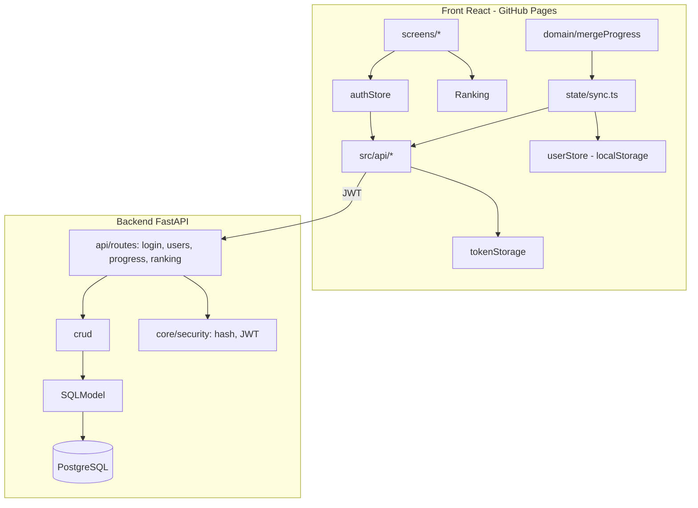

# Backend, Login e Ranking: Design

**Spec**: `.specs/features/backend-auth/spec.md`
**Status**: Draft

---

## Architecture Overview

Dois deploys independentes no mesmo repositório: o **front** (React/Vite,
permanece na raiz) publicado no GitHub Pages, e o **backend** (FastAPI, novo
diretório `backend/`) publicado em um host à parte (a decidir). A comunicação é
HTTP/JSON com CORS restrito à origem do Pages.



**Estado local é a fonte primária offline.** O `userStore` (localStorage) continua
sendo o que a UI lê — o sync nunca bloqueia a jogabilidade. A nuvem é um espelho
para contas logadas.

**Fluxo de login ("link device")**

1. Usuário autentica → backend devolve JWT → `authStore` guarda sessão + token.
2. `GET /me/progress`:
   - conta vazia (`games_played == 0` e sem histórico) → `PUT` com o snapshot local;
   - conta com dados → `mergeProgress(local, cloud)` → `PUT` do resultado → adota no `userStore`.
3. Daqui em diante, cada `recordResult` grava local e **enfileira** o delta no
   `syncQueue` (outbox em localStorage); um flush no boot/login/`online` empurra
   as pendências para `PUT /me/progress`.

---

## Code Reuse Analysis

| Origem | Destino | Como reaproveitar |
| --- | --- | --- |
| `fastapi/full-stack-fastapi-template` (backend) | `backend/**` | Vendorizar; remover front do template e o exemplo `Item` |
| `src/domain/types.ts` | schemas do backend + `src/api/types.ts` | Espelhar `Stats`/`HistoryEntry` (snake_case) |
| `src/state/userStore.ts` | `src/state/sync.ts` | Ler/gravar snapshot; o sync observa a store |
| `src/domain/recordResult.ts` | hook de outbox | Após gravar local, enfileira o delta |
| `src/router.tsx` | rotas novas | Adicionar `/login`, `/cadastro`, `/recuperar`, `/reset`, `/ranking`, `/perfil` |
| `src/components/TopBar.tsx` | acesso à conta | Botão Entrar/Conta |
| `src/styles/style.css` | CSS das telas novas | Adições isoladas (não congelado neste milestone) |

### Integration Points

| Sistema | Integração |
| --- | --- |
| `VITE_API_URL` | Base do client HTTP (build-time) |
| CORS | `BACKEND_CORS_ORIGINS` com a origem do Pages |
| `localStorage` `gramma_user_data` | Inalterado (convidado) |
| `localStorage` `gramma_auth` | Sessão/JWT (novo) |
| `localStorage` `gramma_sync_outbox` | Fila de gravações pendentes (novo) |
| SMTP | E-mail de recuperação (Mailpit em dev) |

---

## Backend

### Estrutura (após o trim)

```
backend/
  app/
    api/
      routes/   login.py, users.py, utils.py, progress.py, ranking.py
      deps.py
    core/       config.py, security.py, db.py
    models.py   User (template) + UserStats, HistoryEntry, AchievementUnlocked
    schemas.py  schemas Pydantic de progresso e ranking
    crud.py     consultas (progresso, ranking)
    main.py     app, CORS, routers, rate limit
    alembic/    migrações
  tests/        test_auth, test_progress, test_ranking, test_security
  pyproject.toml  (uv, ruff, pytest)
  docker-compose.yml  (Postgres + Mailpit)
  .env.example
```

### Data Models (SQLModel)

```python
class User(SQLModel, table=True):          # do template
    id: uuid.UUID
    email: str
    hashed_password: str                    # nunca a senha em claro
    full_name: str | None
    is_active: bool
    is_superuser: bool
    created_at: datetime

class UserStats(SQLModel, table=True):
    user_id: uuid.UUID                      # FK única
    # espelha src/domain/types.ts::Stats
    current_streak: int
    max_streak: int
    last_streak_day: int
    games_played: int
    total_score: int
    morph_correct_streak: int
    morph_correct_streak_max: int
    syntax_correct_streak: int
    syntax_correct_streak_max: int
    synonyms_correct_streak: int
    synonyms_correct_streak_max: int
    total_correct_morph: int
    total_correct_syntax: int
    total_correct_synonyms: int

class HistoryEntry(SQLModel, table=True):
    user_id: uuid.UUID
    day_id: int
    study_type: str                         # 'morphology'|'syntax'|'synonyms'
    correct: bool
    points: int
    base: int
    bonus: int
    is_milestone: bool
    streak_after: int
    time_ms: int
    is_archive: bool
    played_on: date                         # derivado do day_id (janela do ranking)
    # UniqueConstraint(user_id, day_id, study_type)

class AchievementUnlocked(SQLModel, table=True):
    user_id: uuid.UUID
    achievement_id: str
    unlocked_at: datetime
    # UniqueConstraint(user_id, achievement_id)
```

`unlocked_achievements` é derivado de `AchievementUnlocked` (união), evitando
duplicação de fonte. `played_on` é calculado a partir de `day_id` + `START_DATE`
(mesma regra de `src/domain/calendar.ts`) para permitir as janelas de ranking sem
confiar no relógio do cliente.

### API (v1)

| Método | Rota | Corpo / Query | Resposta |
| --- | --- | --- | --- |
| POST | `/api/v1/users/` | `{email, password, full_name?}` | `201` usuário (sem senha) |
| POST | `/api/v1/login/access-token` | form `username=email, password` | `{access_token, token_type}` |
| POST | `/api/v1/password-recovery/{email}` | - | `202` |
| POST | `/api/v1/reset-password/` | `{token, new_password}` | `200` |
| GET | `/api/v1/users/me` | - (JWT) | usuário |
| GET | `/api/v1/me/progress` | - (JWT) | `{stats, history[]}` |
| PUT | `/api/v1/me/progress` | `{stats, history[]}` | `204` (idempotente) |
| GET | `/api/v1/ranking` | `?period=daily\|weekly\|monthly&study_type=&limit=` | `[{rank, display_name, score, streak}]` |

**Janelas do ranking** (formatas em SQL, `is_archive = false`):
- `daily`: `played_on = current_date`
- `weekly`: `played_on >= current_date - interval '6 day'`
- `monthly`: `played_on >= current_date - interval '29 day'`

`display_name` = `full_name` quando houver, senão parte local do e-mail.

---

## Frontend

### Novos módulos

- `src/api/client.ts`: `fetch` com base `VITE_API_URL`, erros tipados
  (`ApiError` com `status`/`detail`), injeção automática do `Authorization`.
- `src/api/auth.ts` / `progress.ts` / `ranking.ts`: funções tipadas por endpoint.
- `src/api/types.ts`: DTOs espelhando os schemas (`StatsDTO`, `HistoryEntryDTO`,
  `RankingRow`, `SessionUser`).
- `src/state/tokenStorage.ts`: leitura/escrita do JWT em `gramma_auth` (isolado
  para permitir troca por cookie httpOnly sem tocar no resto).
- `src/state/authStore.ts`: `{ user, token, status }` via `useSyncExternalStore`;
  `login`, `logout`, `refresh`; escuta `storage` (multi-aba).
- `src/state/sync.ts`: `flushOutbox`, `pullProgress`, `pushProgress`; integra
  `recordResult` (enfileira) e `authStore` (flusha no login/boot).
- `src/domain/mergeProgress.ts`: função pura de merge (T52).
- `src/screens/{Login,Register,ForgotPassword,ResetPassword,Ranking,Profile}.tsx`.
- `src/components/RankRow.tsx`.

### Rotas novas no `router.tsx`

| Rota | Tela | Observação |
| --- | --- | --- |
| `/login` | Login | volta a `/` |
| `/cadastro` | Register | volta a `/login` |
| `/recuperar` | ForgotPassword | volta a `/login` |
| `/reset` | ResetPassword | lê `?token=` (ou `#/reset?token=`) |
| `/ranking` | Ranking | público (lista), destaca se logado |
| `/perfil` | Profile | exige sessão; senão `/login` |

### `mergeProgress` (contrato)

```typescript
mergeProgress(local: UserData, cloud: ProgressDTO): UserData

// history: para cada chave `${day}:${type}` presente em um dos lados, mantém a
//   entrada de maior `points`; empate → menor `time_ms`.
// unlocked_achievements: união dos conjuntos.
// max_streak: máximo entre os lados.
// games_played, total_score, total_correct_*: recomputados do history mesclado.
// current_streak / last_streak_day: da entrada mais recente (maior day_id não-arquivo).
// settings: sempre locais (nuvem não guarda preferências).
```

Funcção pura e determinística, sem I/O — testável isoladamente.

---

## Error Handling Strategy

| Cenário | Tratamento | Impacto |
| --- | --- | --- |
| Rede indisponível no login | Erro no formulário; permanece convidado | Nada perdido |
| 401 em chamada autenticada | `authStore.logout()` + mensagem | Volta a convidado |
| 409 no registro (e-mail em uso) | Mensagem no formulário | Usuário troca e-mail |
| `PUT` reenviado | Upsert idempotente | Sem duplicar |
| Jogada offline | Vai para `gramma_sync_outbox` | Enviada ao reconectar |
| Token de reset inválido/expirado | 400 no reset | Pede novo e-mail |
| Rate limit excedido | 429 com `Retry-After` | Usuário espera |
| Backend fora do ar | Front continua offline | Jogo jogável |
| `VITE_API_URL` ausente | Client falha claro no boot (dev) | Configurar env |

---

## Tech Decisions (não óbvias)

| Decisão | Escolha | Racional |
| --- | --- | --- |
| Base do backend | `full-stack-fastapi-template`, só o backend | Auth/JWT/reset/Alembic prontos; menos risco que escrever do zero |
| Front do template | Descartado | Já temos front React; evitar dois frameworks |
| E-mail de reset | HTML simples via `fastapi-mail` | Remove Node/React Email do backend |
| Gerenciador Python | `uv` (do template) | Já é o padrão do template; lockfile reproduzível |
| Onde vivem as preferências | Só no `localStorage` | Tema/fonte são por dispositivo; nuvem guarda só progresso competitivo |
| Token no front | JWT em `gramma_auth`, isolado em `tokenStorage.ts` | Simples agora; trocar por cookie httpOnly depois da hospedagem sem refatorar o resto |
| Idempotência do progresso | Upsert por `(user_id, day_id, study_type)` | Reenvios seguros; base do outbox |
| Ranking | `SUM(points)` por janela em SQL, `is_archive` excluído | Simples, indexável; sem materialized views nesta fase |
| Data da jogada | `played_on` derivado de `day_id` no servidor | Não confia no relógio do cliente; casa com `START_DATE` do front |
| Sync | Local-first + outbox (link device) | Convidado inalterado; offline não bloqueia |
| Props de exibição no ranking | `full_name` ou prefixo do e-mail | Evita expor e-mail completo de terceiros |

---

## Testing Strategy

- **Backend (Pytest)**: `test_auth.py` (registro/login/reset, 409/422/429),
  `test_progress.py` (isolamento por usuário, idempotência), `test_ranking.py`
  (janelas e filtros com dados semeados), `test_security.py` (CORS/limite).
  Postgres via Docker ou serviço no CI.
- **Front (Vitest + Testing Library)**: `client.test.ts` (401/rede, mock fetch),
  `authStore.test.ts`, `mergeProgress.test.ts`, `sync.test.ts`, telas com client
  mockado, e `jest-axe` nas telas novas; fluxos de integração atualizados.
- Gates: backend `ruff check backend && pytest`; front
  `npm run typecheck && npm run lint && npm test`.
