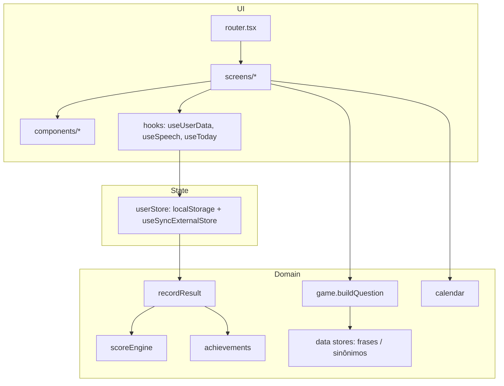

# Port para React + TypeScript: Design

**Spec**: `.specs/features/port-react/spec.md`
**Status**: Draft

---

## Architecture Overview

Três camadas com dependência em um só sentido: `domain` (funções puras, sem React nem DOM) → `state` (persistência e hooks) → `screens`/`components` (UI).



**Fluxo de uma jogada:** `Game` monta a pergunta (`useState` lazy) → clique → `setTimeout(900 ms)` → `recordResult(userData, …)` → `userStore.save` → `navigate('/fim/:dia', { state: { newlyUnlocked } })`. `End` lê a entrada de `history` da store; conquistas novas vêm do `location.state` (vazio ao abrir um resultado salvo ou recarregar).

**Grafo de rotas (HashRouter)**

| Rota | Tela | Voltar/saída |
| --- | --- | --- |
| `/` | Menu | (raiz) |
| `/modo` | ModeHub | `/` |
| `/jogo/:dia` | Game, ou redireciona a `/fim/:dia` se já jogado hoje | `/modo` |
| `/fim/:dia` | End | `/modo` |
| `/calendario` | Calendário | `/modo`; clicar no dia → `/jogo/:dia` |
| `/estatisticas` | Stats | `/modo` |
| `/conquistas` | Conquistas | `/` |
| `/acessibilidade` | Acessibilidade | `/` |
| `/como-jogar` | Como jogar | `/` |
| `/intro` | Intro | fim/skip → `/` |

Boot (`main.tsx`): se `location.search` tem `?day=N` válido, `location.hash = #/jogo/N` e remove a query; senão, se a intro ainda não foi vista na sessão, vai a `/intro`.

---

## Code Reuse Analysis

Port quase literal, ganhando tipos. O legado é movido para `legacy/` na T2 e consultado durante o port.

| Componente legado | Destino | Como reaproveitar |
| --- | --- | --- |
| `js/scoreEngine.js` | `src/domain/scoreEngine.ts` | Copiar, tipar, acrescentar testes |
| `js/achievements.js` | `src/domain/achievements.ts` | Copiar; `isUnlocked(stats: Stats)` |
| `js/gameEngine.js` (datas) | `src/domain/calendar.ts` | Extrair `getCurrentDayId`, `dateForDay`, `dayIdForDate`; relógio injetável |
| `js/gameEngine.js` (`buildPrompt`, `shuffle`, clamp) | `src/domain/game.ts` | Funções puras; `Math.random` injetável |
| `js/dataStore.js`, `synonymStore.js` | `src/data/stores.ts` | JSON importado direto |
| `js/storageService.js` | `src/domain/recordResult.ts` + `src/state/userStore.ts` | Separar regra (pura) de I/O |
| `js/uiController.js` | `screens/*`, `components/*` | Cada `render*` vira um componente |
| `js/main.js` | `router.tsx`, `App.tsx`, `main.tsx`, telas | Handlers viram props/`navigate` |
| `css/style.css`, `index.html` (marcação) | `src/styles/style.css`, JSX | Mesmas classes e ids de teste |
| `database_*.json` | `src/data/*.json` | `git mv` |
| `js/vendor/gsap.min.js` | dependência npm | `gsap` + `@gsap/react` |

### Integration Points

| Sistema | Integração |
| --- | --- |
| `localStorage` `gramma_user_data` | Mesma chave/formato (STO-01) |
| `sessionStorage` `gramma_intro_seen` | Mesma chave (NAV-03) |
| Web Speech API | `useSpeech` com detecção de suporte |
| Clipboard API | `shareResult` com fallback para texto no toast |
| GitHub Pages | `base: '/Gramma/'` + workflow Actions |

---

## Components

### domain/scoreEngine
- **Purpose**: Pontos por modo e bônus de marco.
- **Interfaces**: `calculatePoints(type: StudyType, isCorrect: boolean, streakAfter: number): Score`; `BASE_POINTS`.
- **Dependencies**: `types`.

### domain/achievements
- **Interfaces**: `ACHIEVEMENTS: Achievement[]`; `evaluateAchievements(stats): string[]`; `getAchievement(id)`.

### domain/calendar
- **Interfaces** (todas aceitam `now: Date = new Date()` onde aplicável):
  - `getCurrentDayId(now?): number`
  - `dateForDay(dayId): Date`, `dayIdForDate(date): number`
  - `buildMonthCells(viewDate): (MonthCell | null)[]`
  - `canNavigate(viewDate, totalDays): { prev: boolean; next: boolean }`
- **Reuses**: constantes `START_DATE` e `DAY_MS` do legado.

### domain/game
- **Interfaces**:
  - `resolveDay(requested: number, current: number, total: number): { dayId: number; isArchive: boolean }`
  - `buildQuestion(type, dayId, rng = Math.random): Question`
  - `splitHighlight(sentence: string, target?: string): { before: string; highlight: string; after: string }`
  - `shuffle<T>(items: T[], rng?): T[]`
- **Nota**: `Question.prompt` é `PromptPart[]`, sem HTML (evita `dangerouslySetInnerHTML`).

### domain/recordResult
- **Interfaces**: `recordResult(data: UserData, input: { dayId; type; correct; timeMs; isArchive }): { data: UserData; score: Score; streak: number; newlyUnlocked: string[] }`
- **Dependencies**: `scoreEngine`, `achievements`. Pura: não toca no storage.

### state/userStore
- **Purpose**: Única fonte de verdade persistida.
- **Interfaces**: `getSnapshot(): UserData` (cacheado); `subscribe(cb)`; `update(fn: (d: UserData) => UserData): void`; `createDefaultUserData()`; `parseStored(raw: string | null): UserData`.
- **Detalhes**: `update` grava e invalida o cache; escuta o evento `storage` (outras abas).

### state/useUserData, state/theme, state/fontScale
- `useUserData(): UserData` e seletores; `useTheme(): { isDark; toggle }`; `useFontScale(): { index; label; change(dir) }`. Aplicam `data-theme` e `--font-scale` em `<html>` via `useEffect`.

### hooks/useToday, hooks/useSpeech
- `useToday(): number` (dia atual, lido na montagem da tela); `useSpeech(text): { supported; speak() }`.

### components
- `ScreenTransition`: envolve uma tela; `useGSAP` anima entrada; saída via `Outlet` com chave de rota (ver Tech Decisions).
- `TopBar`: tema + acessibilidade, só renderizado no Menu.
- `AnswerButton`: letra, texto, estado `idle|correct|wrong`, ícone de resultado.
- `CalendarGrid`: células e status.
- `AchievementCard`, `AchievementToast`, `StatRow`, `Sparkles`, `Toast` (compartilhar), `IconButton`, `MaterialIcon`.

### screens
Menu, ModeHub, Game, End, Calendar, Stats, Achievements, Accessibility, HowToPlay, Intro. Cada uma segue a marcação e as classes de `index.html`.

---

## Data Models

```typescript
export type StudyType = 'morphology' | 'syntax' | 'synonyms';

export interface Settings { dark_mode: boolean; study_type: StudyType; font_scale_index: number }

export interface Stats {
  current_streak: number; max_streak: number; last_streak_day: number;
  games_played: number; total_score: number;
  morph_correct_streak: number; morph_correct_streak_max: number;
  syntax_correct_streak: number; syntax_correct_streak_max: number;
  synonyms_correct_streak: number; synonyms_correct_streak_max: number;
  total_correct_morph: number; total_correct_syntax: number; total_correct_synonyms: number;
  unlocked_achievements: string[];
}

export interface HistoryEntry {
  day_id: number; study_type: StudyType; correct: boolean;
  points: number; base: number; bonus: number; is_milestone: boolean;
  streak_after: number; time_ms: number; is_archive: boolean;
}

export interface UserData {
  uuid: string; settings: Settings; stats: Stats;
  history: Record<`${number}:${StudyType}`, HistoryEntry>;
}

export interface Score { base: number; bonus: number; total: number; isMilestone: boolean }

export interface GrammarDay {
  day_id: number; sentence: string; target_word: string;
  morphology: { answer: string; options: string[] };
  syntax: { answer: string; options: string[] };
}
export interface SynonymEntry { word_id: number; word: string; answer: string; options: string[] }

export type PromptPart = { text: string; highlight?: boolean };
export interface Question { prompt: PromptPart[]; options: string[]; answer: string }
```

**Relationships**: `history` é indexado por `"{dia}:{modo}"`; `stats.*` agregam o histórico; `settings` são independentes.

---

## Error Handling Strategy

| Cenário | Tratamento | Impacto |
| --- | --- | --- |
| JSON do storage inválido | `parseStored` captura, `console.error`, defaults | Progresso reinicia (igual ao legado) |
| `setItem` falha (cota/privado) | `try/catch` em `save`; cache em memória continua | Jogo funciona; não persiste |
| `crypto.randomUUID` ausente | Fallback para `Math.random`-based id | Nenhum |
| `:dia` inválido ou > total | Redireciona a `/` | Volta ao Menu |
| Clipboard negado | `catch` → mostra o texto no toast | Usuário copia manualmente |
| Sem `speechSynthesis` | Botão desabilitado com `title` | Sem leitura |
| Sem `gsap` (falha de import) | Não se aplica: dependência empacotada | n/a |

---

## Tech Decisions (não óbvias)

| Decisão | Escolha | Racional |
| --- | --- | --- |
| Snapshot da store | Objeto cacheado, invalidado em `update`/`storage` | `useSyncExternalStore` exige referência estável; o `load()` legado cria objeto novo a cada chamada e entraria em loop |
| Persistir resultado ao responder | Gravar uma vez no callback do timeout; guard `useRef` contra duplo disparo | StrictMode monta efeitos duas vezes; gravar em efeito duplicaria `games_played` (GAME-07) |
| Embaralhar | `useState(() => buildQuestion(...))` com `key={`${dia}-${modo}`}` no componente | Estável em re-render; novo por pergunta |
| Resultado da jogada | End lê `history` salvo; só `newlyUnlocked` via `location.state` | Elimina `window.currentShareData` e unifica "resultado ao vivo" e "resultado salvo" |
| Frase destacada | `PromptPart[]`, sem HTML | Seguro, testável, sem `dangerouslySetInnerHTML` |
| Saída animada de tela | `useGSAP` na entrada; saída por `useBlocker`/estado `leaving` curto (0,14 s) antes do `navigate` | Reproduz o fade de saída sem biblioteca de rotas animadas |
| Flip do tema | Ref do botão + timeline que troca o tema em `.call()` | O valor no store muda no clique; só `data-theme`/ícone esperam o ponto fechado |
| Relógio | `now` injetável nas funções de calendário; testes usam `vi.setSystemTime` | Determinismo na virada de mês/dia |
| CSS | `style.css` global copiado sem refatorar | Paridade visual; refatorar é M2 |
| Ícones | Fonte Material Symbols mantida como no `index.html` | Paridade; sem troca de lib |
| Dados | JSON em `src/data` (`resolveJsonModule`) | Fonte única; remove `build-data.js` |
