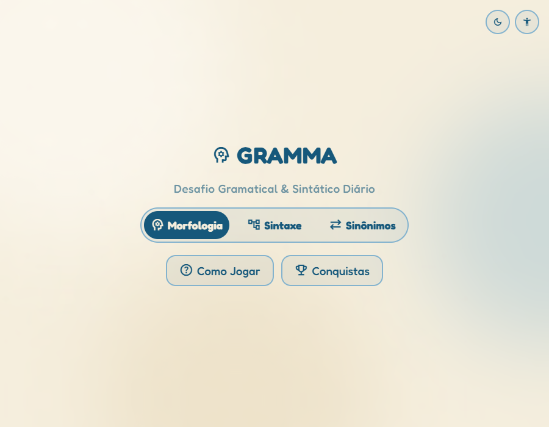
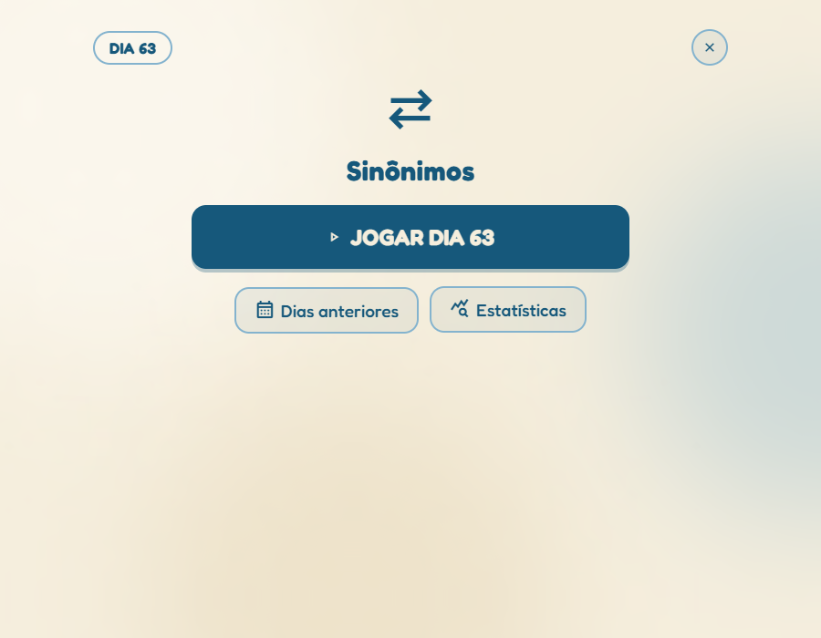
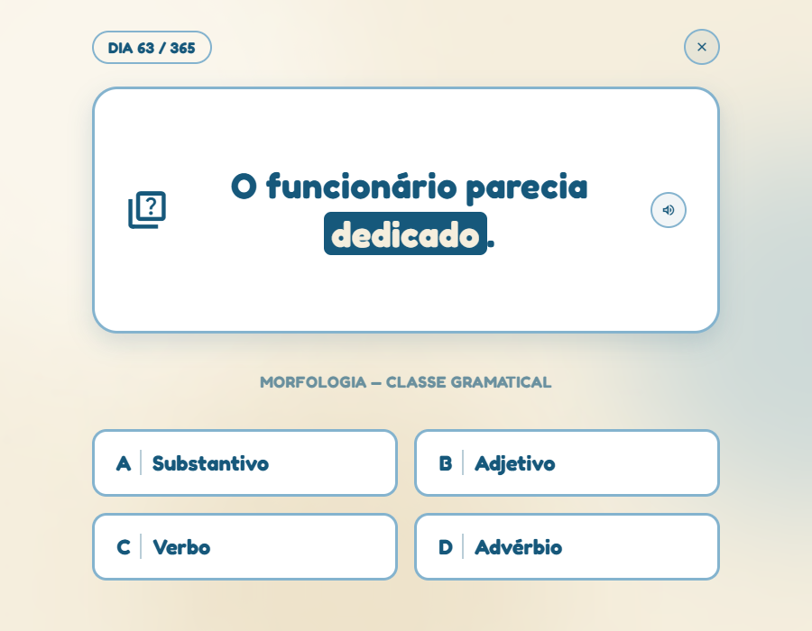

# GRAMMA


Este projeto foi desenvolvido para a matéria de Jogos Digitais do curso de
Sistemas de Informação do Centro Universitário do Rio São Francisco -
UniRios, ministrada pelo Professor Dr. Erick Barros.

GRAMMA é um desafio gramatical e sintático diário, no estilo Wordle/Termo,
focado em três frentes da língua portuguesa: classes gramaticais, funções
sintáticas e sinônimos.

O jogo funciona offline como convidado (progresso no navegador) e, de forma
**opcional**, com conta no backend (FastAPI) para manter a sessão entre
dispositivos.

## Tela Inicial



Tela inicial do jogo, onde o jogador escolhe o modo de estudo do dia:
Morfologia, Sintaxe ou Sinônimos.

## Menu do Modo



Depois de escolher o modo, o jogador acessa o desafio do dia, o
calendário de dias anteriores e as estatísticas daquele modo.

## Interface do Jogo



Interface de uma pergunta, com a frase do dia, a palavra em destaque e as
quatro alternativas de resposta.

## Ajustes e melhorias

O jogo ainda está em desenvolvimento e as próximas atualizações serão
voltadas para as seguintes tarefas:

- Mascote ou fio narrativo leve nas telas de feedback
- Jogo instalável (PWA / manifest.json)
- Camada Canvas/WebGL nos efeitos de celebração

## Tecnologias

- **React 19** + **TypeScript** (strict)
- **Vite** como bundler e servidor de desenvolvimento
- **React Router** (`HashRouter`, funciona em qualquer host estático)
- **GSAP** + `@gsap/react` para as animações
- Estado do jogador em store externa (`useSyncExternalStore`) sobre o
  `localStorage`
- **Vitest** + Testing Library para os testes
- **Backend opcional**: **FastAPI** + **SQLModel** + **Alembic** + **JWT**
  (conta e sessão), em `backend/`

## Pré-requisitos

- Node.js 20 ou superior
- npm
- Python 3.13 (apenas para rodar o backend)

## Executando localmente

Instale as dependências e suba o servidor de desenvolvimento:

```
npm install
npm run dev
```

Depois abra o endereço exibido no terminal (por padrão,
`http://localhost:5173`).

### Backend (opcional)

O front conversa com o backend para login/cadastro. Em desenvolvimento, o Vite
faz proxy de `/api` para `http://localhost:8000`, então não há CORS. Para subir
a API, veja [`backend/README.md`](backend/README.md). Sem backend no ar, o jogo
segue funcionando como convidado — a tela de acesso exibe um erro de conexão.

A variável `VITE_API_URL` (veja `.env.example`) define a origem do backend. Em
produção, aponte para o backend publicado.

## Scripts disponíveis

| Script | Descrição |
|---|---|
| `npm run dev` | Servidor de desenvolvimento (Vite) |
| `npm run build` | Checagem de tipos (`tsc --noEmit`) e build de produção em `dist/` |
| `npm run preview` | Serve o build de produção localmente |
| `npm run typecheck` | Checagem de tipos sem gerar arquivos |
| `npm run lint` | ESLint |
| `npm test` | Testes (Vitest), uma execução |
| `npm run test:cov` | Testes com relatório de cobertura |

## Estrutura do Projeto

```
src/
  api/          client HTTP tipado (client.ts, auth.ts, types.ts)
  domain/       tipos e regras puras (scoreEngine, achievements, calendar, game, share)
  data/         grammar-days.json (365 dias), synonyms.json (100 palavras) e stores.ts
  state/        userStore (localStorage), authStore (sessão/backend), hooks
  hooks/        useSpeech, useAnimatedNavigate
  components/   AnswerButton, CalendarGrid, TopBar, Sparkles, Toast, ...
  screens/      Intro, Menu, ModeHub, Game, End, Calendar, Stats,
                Achievements, Accessibility, HowToPlay, Auth, Profile
  styles/       style.css (design system, temas claro/escuro)
  App.tsx, main.tsx, router.tsx, boot.ts
public/         favicon.svg, unirios-logo.png
backend/        API FastAPI (auth: login, cadastro, /users/me)
legacy/         versão antiga (HTML/CSS/JS puro), mantida como referência
```

## Rotas

As telas são acessadas por hash (ex.: `/#/modo`):

`/` · `/modo` · `/jogo/:dia` · `/fim/:dia` · `/calendario` ·
`/estatisticas` · `/conquistas` · `/acessibilidade` · `/como-jogar` ·
`/intro` · `/entrar` · `/perfil`

O parâmetro `?day=N` (ex.: `http://localhost:5173/?day=42`) abre
diretamente o desafio daquele dia e pula a introdução.

## Conta e backend

O acesso é **opcional**. Como convidado, tudo fica no `localStorage`. Ao criar
conta ou entrar (tela `/entrar`), o front usa o backend FastAPI:

- `POST /api/v1/users/signup` — cria a conta
- `POST /api/v1/login/access-token` — login (OAuth2, e-mail + senha) → JWT
- `GET /api/v1/users/me` — valida a sessão

A sessão (token + usuário) fica em `gramma_auth` no `localStorage`. Endpoints de
progresso/ranking na nuvem ainda não existem — o progresso do jogo continua
local.

## Banco de dados

O conteúdo do jogo tem o `.json` como fonte única, editável por qualquer
pessoa do time:

- `src/data/grammar-days.json`: 365 dias de morfologia e sintaxe
- `src/data/synonyms.json`: banco de palavras difíceis do modo Sinônimos

Os JSON são importados diretamente por `src/data/stores.ts` e expostos
pelos `DataStore` e `SynonymStore` tipados — não há mais passo de geração
(`build-data.js`) nem cópias `.js`. Como o banco de sinônimos tem menos
entradas que os 365 dias, ele repete em ciclo.

O backend tem seu próprio banco (PostgreSQL via Docker Compose) para as contas
de usuário; veja [`backend/README.md`](backend/README.md).

## Progresso do jogador

O progresso fica no `localStorage` sob a chave `gramma_user_data`, no
mesmo formato da versão anterior — quem já jogava não perde nada ao
atualizar.

## Deploy

O front é um build estático (`npm run build` → `dist/`), servido por qualquer
host estático (Vercel, Netlify, Nginx, `npm run preview`, ...). O backend é
publicado separadamente; configure `VITE_API_URL` no build do front e
`FRONTEND_HOST` no backend para liberar o CORS.

## Histórico e documentos originais

O desenho do jogo mudou bastante desde a proposta inicial (modo difícil
removido, sinônimos adicionado, paleta de cores refeita, entre outros). O
histórico dessas decisões está em [`CHANGELOG.md`](CHANGELOG.md); o plano
do port para React está em [`PLANO-PORT-REACT.md`](PLANO-PORT-REACT.md);
os documentos originais (`ideia.md`, `ferramentas.md`,
`spec-design-jogo.md`) ficam no repositório como registro histórico.

## Colaboradores

Este projeto foi desenvolvido para a matéria de Jogos Digitais do curso
de Sistemas de Informação do Centro Universitário do Rio São Francisco -
UniRios, ministrada pelo Professor Dr. Erick Barros:

| [GlauberMargem](https://github.com/GlauberMargem) | [Yurialvessmoreiraaa](https://github.com/Yurialvessmoreiraaa) | [anthonyysm](https://github.com/anthonyysm) |
| :---: | :---: | :---: |
|  |  |  |
